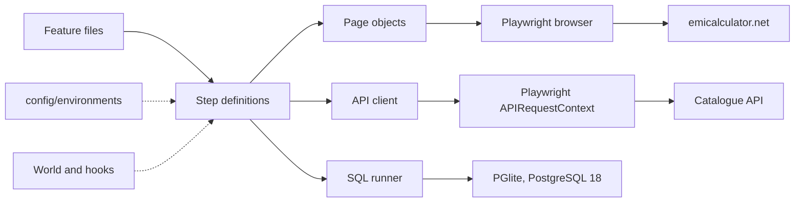
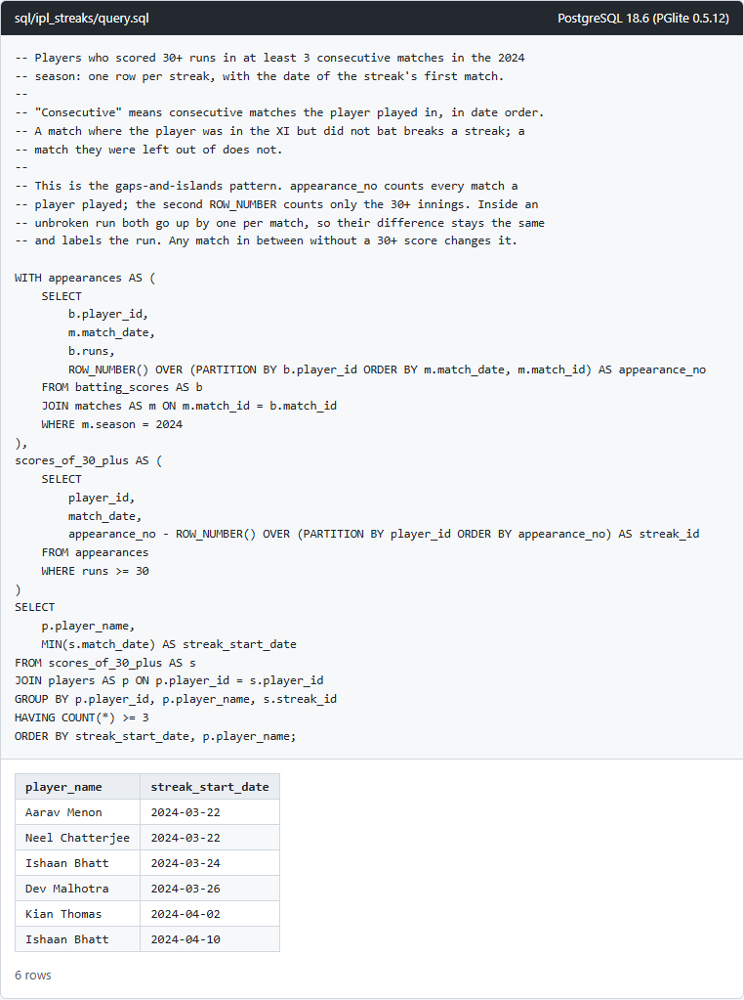

# Streamhub QA automation assessment

[](https://github.com/mohitpal2621/streamhub-qa-automation/actions/workflows/tests.yml)

My solution to Section B of the Streamhub Fullstack + QA Automation assessment:

- B1: a small catalogue API (videos, channels, view statistics) served from JSON files, with filtering, search, sorting, paging and validation errors.
- B2: Playwright API tests for it, written as Cucumber features.
- B3: the two emicalculator.net test cases (pie chart and bar chart), automated with Playwright and Cucumber.
- B4: the two SQL scenarios, with schemas, sample data, queries, output screenshots and automated checks.
- The AI self-healing exercise: five deliberately broken locators, a write-up, and a working proof of concept that repairs them with Claude.

Everything is one TypeScript framework: feature files, step definitions, page objects (and an API client that plays the same role for the API), with URLs and timeouts in environment files.

## Results

The latest run of every suite is committed under [`reports/`](reports/README.md), with HTML reports, JUnit XML, console output and screenshots.

| Suite | Scenarios | Result |
| --- | --- | --- |
| API (`npm run test:api`) | 120 | all passed |
| UI on emicalculator.net (`npm run test:ui`) | 3 | all passed |
| SQL (`npm run test:sql`) | 13 | all passed |
| Self-healing, healing off (`npm run test:healing:off`) | 2 | 1 failed, as intended: the broken locators as written |
| Self-healing, heuristic healer (`npm run test:healing`) | 2 | all passed, 4 locators repaired, 1 correctly refused |
| Self-healing, Claude healer (`npm run test:healing:claude`) | 2 | all passed, 4 locators repaired, 1 correctly refused |

[`reports/README.md`](reports/README.md) has the per-suite numbers, links to each report and every screenshot inline. To browse an HTML report, download it and open it in a browser.

## Setup

You need Node.js 22 or newer (developed on Node 24.20, Windows 11). Then:

```bash
npm install
```

```bash
npx playwright install chromium
```

No database or other service is needed. The API tests start the API themselves and the SQL tests use an in-process PostgreSQL.

## Running

```bash
npm test
```

That runs the API, SQL and UI suites in turn. Each suite also has its own script:

| Command | What it runs |
| --- | --- |
| `npm run test:api` | B2, 120 API scenarios (about 2 seconds) |
| `npm run test:ui` | B3, the emicalculator.net scenarios (about a minute, needs internet) |
| `npm run test:sql` | B4, the SQL scenarios (under 30 seconds) |
| `npm run test:healing:off` | self-healing demo with the broken locators as written |
| `npm run test:healing` | self-healing demo with the offline heuristic healer |
| `npm run test:healing:claude` | self-healing demo with Claude (see the [write-up](docs/self-healing-locators.md)) |
| `npm run sql:run` | runs the SQL queries and saves their output and screenshots in `sql/results/` |
| `npm run report:summary` | rebuilds `reports/README.md` from the latest runs |
| `npm run api` | starts the API on port 3000 for manual use |
| `npm run typecheck` | TypeScript type check |

Each test script empties its folder in `reports/` first and writes `cucumber-report.html`, `cucumber-report.json`, `junit.xml` and `console.txt` there, plus screenshots for the UI suites. A failed UI scenario also leaves a Playwright trace in `traces/` (open it with `npx playwright show-trace <file>`; traces are not committed).

To watch the browser, set `HEADLESS=false` in a `.env` file (see `.env.example`).

### Environments

Settings live in [`config/environments/`](config/environments/): `local.env` is the default and `ci.env` is used with `TEST_ENV=ci`. A git-ignored `.env` overrides either, and real environment variables override everything. Nothing in the code holds a URL; [`tests/support/config.ts`](tests/support/config.ts) reads them and fails at start-up if one is missing.

```bash
TEST_ENV=ci npm run test:api
```

`API_BASE_URL` points the API tests at any running instance. With `START_API_SERVER=true` (the default) the test run starts the API in-process on that URL's port, unless something already answers there.

## Layout

```
api/                      B1: the API under test
  data/                   the mock database: videos.json, channels.json
  openapi.yaml            the API contract; the tests validate responses against it
  src/                    Express app, query validation, routes
tests/
  features/               Gherkin: api/, ui/, sql/, self-healing/
  steps/                  step definitions
  pages/                  page objects for emicalculator.net, and the brittle one for the healing demo
  api/                    API client object and OpenAPI contract checks
  support/                config, world, hooks, loan maths oracle, SQL runner
  self-healing/           the self-healing proof of concept
sql/                      B4: one folder per scenario, plus results/
config/environments/      environment files
reports/                  committed test results
docs/                     self-healing write-up
```

## Architecture



- Feature files describe behaviour only. Step definitions translate each step into calls on page objects, the API client or the SQL runner, and hold the assertions.
- Page objects own every locator. [`EmiCalculatorPage`](tests/pages/EmiCalculatorPage.ts) is made of components: the loan form and its sliders, the payment summary, the pie and bar charts, and the start month picker.
- [`CatalogueApi`](tests/api/CatalogueApi.ts) is the API's page object: steps call `get('/videos?limit=5')` or `listVideos({...})` and never build URLs or parse responses themselves.
- The [world](tests/support/world.ts) carries per-scenario state. [Hooks](tests/support/hooks.ts) start the browser (one per run, a fresh context per scenario), the API server, or a fresh in-memory database, depending on the scenario's tag: `@ui`, `@api` or `@sql`.
- Cucumber profiles in [`cucumber.js`](cucumber.js) select the features and the report folder for each suite.

## B1: the catalogue API

Base path `/api/v1`. All endpoints are read-only and return JSON. The full contract is [`api/openapi.yaml`](api/openapi.yaml).

| Endpoint | Query parameters |
| --- | --- |
| `GET /videos` | `q` (search title and tags, 2 to 100 characters), `category` (comma-separated list), `channelId`, `live` (`true`/`false`), `minDuration`, `maxDuration` (seconds), `from`, `to` (`YYYY-MM-DD`, inclusive), `sort` (`publishedAt`, `views`, `durationSeconds`, `title`, with `-` for descending; default `-publishedAt`), `page` (1 to 10000), `limit` (1 to 50, default 10) |
| `GET /videos/{videoId}` | none; returns the video with its channel |
| `GET /channels` | `q`, `country` (`GB`), `verified`, `minSubscribers`, `sort` (`name`, `subscribers`, `createdAt`), `page`, `limit` |
| `GET /stats/views` | `groupBy` (required: `category`, `channel` or `month`), `from`, `to`, `top` (1 to 20) |
| `GET /health` | none |

Lists come back as `{ data: [...], pagination: { page, limit, totalItems, totalPages } }`. A page past the end is an empty `data` array, not an error. Sorting breaks ties by id, so paging through a sorted list never repeats or skips an item.

Errors always have the same shape and list every problem in the request at once:

```bash
curl "http://localhost:3000/api/v1/videos?limit=0&sortBy=views"
```

```json
{
  "error": {
    "status": 400,
    "code": "UNKNOWN_PARAMETER",
    "message": "2 problems with the request: sortBy, limit",
    "details": [
      { "parameter": "sortBy", "code": "UNKNOWN_PARAMETER", "message": "Unknown query parameter \"sortBy\". Allowed parameters: q, category, channelId, live, minDuration, maxDuration, from, to, sort, page, limit" },
      { "parameter": "limit", "code": "INVALID_PARAMETER", "message": "limit must be an integer between 1 and 50", "value": "0" }
    ]
  }
}
```

| Status | Code | When |
| --- | --- | --- |
| 400 | `UNKNOWN_PARAMETER` | a query parameter the endpoint does not take, so a typo such as `sortBy` is not silently ignored |
| 400 | `MISSING_PARAMETER` | `groupBy` missing on `/stats/views` |
| 400 | `INVALID_PARAMETER` | wrong type, out of range, not in the allowed set, given twice, `from` after `to`, `minDuration` above `maxDuration`, malformed id or URL |
| 404 | `NOT_FOUND` | unknown video id or route |
| 405 | `METHOD_NOT_ALLOWED` | anything but GET or HEAD, with an `Allow` header |

## B2: API tests

The features are in [`tests/features/api/`](tests/features/api/). They cover:

- every endpoint and parameter on the happy path: each filter alone, filters combined with sorting and paging, all eight sort orders, page boundaries, an empty search, the last page, a page past the end, and collecting every page of a sorted list to check nothing repeats or goes missing;
- invalid and edge-case parameters: zero, negative and too-large numbers, numbers beyond `Number.MAX_SAFE_INTEGER`, words and decimals where integers belong, impossible dates such as 2026-02-30, wrong-case enum values, an empty value, a parameter given twice, unknown parameters, the missing required `groupBy`, and a 100 and 101 character search term;
- status codes and response shape for valid and invalid requests alike: every response is validated against the schema that `api/openapi.yaml` documents for that path, method and status code, using Ajv. Responses that the spec does not describe, such as an unknown route, are checked against its `Error` schema.

Expected counts and ids in the features were worked out by hand from the JSON files. Two scenarios check one endpoint against another: each channel's `videoCount` against `/videos?channelId=...`, and every `/stats/views` group against the videos the videos endpoint returns for the same filter.

A quick mutation check shows the tests can fail: making `to` exclusive in the API failed 1 scenario, and letting `limit` go one above its maximum failed 3. Both changes were reverted, and the suite passes again.

## B3: UI tests on emicalculator.net

The features are [`emi-pie-chart.feature`](tests/features/ui/emi-pie-chart.feature) (test case 1, scenarios A and B) and [`emi-bar-chart.feature`](tests/features/ui/emi-bar-chart.feature) (test case 2).

| Brief | How it is done |
| --- | --- |
| Launch the application | `EmiCalculatorPage.open()` with `EMI_CALCULATOR_URL` from config; waits for the heading and for the pie chart to be drawn |
| Open the Home Loan / Personal Loan tab | clicks the tab link by role and name and waits for the amount label to change to "Home Loan Amount" or "Personal Loan Amount". Home Loan is already selected on load; the test clicks it anyway, as the brief asks. |
| Enter 25L / 10% / 10 years and 50L / 7.5% / 15 years | types into the boxes found by their labels; amounts are written `25L` in the feature, as in the brief |
| Calculate the EMI in code and compare | [`tests/support/emi.ts`](tests/support/emi.ts) computes EMI, total interest and total payment from the reducing-balance formula. The step polls the page until it matches to the rupee. Scenario A: EMI ₹33,038, interest ₹14,64,522, total ₹39,64,522. |
| Pie chart visible and available | container visible, title "Break-up of Total Payment", two drawn slices |
| Values from both sections greater than zero | reads each slice's visible percentage label and the value behind it from the page's Highcharts object; fails if either is not above zero. A further step checks the slices equal the principal and my computed interest, and the labels the right percentages. |
| Set 10L / 12% / 5 years with the sliders | [`Slider`](tests/pages/components/Slider.ts) reads the slider's printed scale, drags the handle to the target's position, then taps the arrow keys until the text box shows the exact value (one pixel of track can be more than one slider step) |
| Change the start month in the calendar | [`MonthPicker`](tests/pages/components/MonthPicker.ts) opens the "Schedule showing EMI payments starting from" calendar, steps to 2027 with the arrows and picks June |
| Bar chart visible, count the bars | 6 bars, 2027 to 2032, because a 60-month loan starting in June 2027 touches six calendar years; checked against the year labels, the bars of each series, and my own schedule. Each bar stacks a principal and an interest segment. |
| Tooltip values of a bar | hovers the principal and interest segments of the 2028 bar and checks "Principal", "Interest" and "Total Payment" against my amortisation schedule for 2028 (₹1,66,492, ₹1,00,441, ₹2,66,933) |

Some details that took care:

- The balance line has an invisible 22-pixel hover band that covers parts of the bars, so a plain hover can land on the line. `BarChart.hover()` uses Playwright's trial hover to find a spot where the bar itself receives the mouse.
- Highcharts animates every redraw. Screenshots and chart reads wait until the chart's SVG has stopped changing for ten frames.
- Requests to ad and analytics hosts are aborted. The ads load slowly and move the layout. Scenarios on this live site get one retry, which shows up in the report if used.

### Locator strategy

Locators use roles, labels and visible text wherever the site exposes them, and never positional CSS or XPath. Where a third-party widget has no role or name, they use the site's own ids, which are not positional.

| Element | Locator |
| --- | --- |
| Loan tabs | `getByRole('link', { name: 'Personal Loan', exact: true })` |
| Amount, interest, tenure | `getByLabel('Personal Loan Amount')`, `getByLabel('Interest Rate')`, `getByLabel('Loan Tenure')` |
| Years/months toggle | `getByRole('radio', { name: 'Yr' })` |
| EMI, total interest, total payment | the paragraph in the summary block whose heading is "Loan EMI", "Total Interest Payable" or "Total Payment" |
| Sliders | `#<input id>slider`, found from the labelled input (jQuery UI sliders have no role or name) |
| Start month | `getByLabel('Schedule showing EMI payments starting from')`, then the visible month panel and `getByText('Jun', { exact: true })` |
| Charts | `#emipiechart`, `#emibarchart`, then Highcharts' documented class names inside them |
| Bar series | found through the legend entry ("Principal", "Interest"), not by assuming an order |

## B4: SQL

[`sql/README.md`](sql/README.md) has the schemas, the queries with the reasoning behind them, the output screenshots and the cases in the sample data. In short:

- Round trips: a self-join on reversed accounts, the return later than the payment and at most 24 hours after it, the amount within 10% of the original. Comparing `(txn_time, txn_id)` reports each round trip once even when both transfers share a timestamp. 6 round trips in the sample data.
- IPL streaks: gaps and islands with two `ROW_NUMBER()`s, so a five-match streak is one row and two streaks in a season are two rows. 6 streaks in the sample data.

The SQL features compare the output with hand-worked expected rows, then run ten deliberately wrong versions of the queries and check that the sample data exposes each one.



## AI self-healing

[`docs/self-healing-locators.md`](docs/self-healing-locators.md) covers detection, the prompt, and the validation a repair must pass before a test uses it. The proof of concept runs the five broken locators in [`BrittleEmiCalculatorPage`](tests/pages/BrittleEmiCalculatorPage.ts) through a healer, Claude or an offline heuristic, then through the checks, and writes a report with a suggested diff for each repair. It never edits source files. [Claude's report](reports/self-healing/healing-on-claude/heal-report.md) shows four repairs and one refusal: for a "Calculate EMI" button that does not exist on the page, it returned no candidates.

## Notes and limitations

- The UI tests run against the live emicalculator.net. If the site changes its markup, the page objects need updating, which is the problem the self-healing proof of concept is about.
- The healer's Claude API path has not been run against the live API, because this machine has no API key. The committed Claude run went through Claude Code instead; the API path type-checks against the SDK.
- PGlite is PostgreSQL 18.6 compiled to WebAssembly. The queries use nothing PGlite-specific.
- The CI workflow in [`.github/workflows/tests.yml`](.github/workflows/tests.yml) runs the type check, the API, SQL and UI suites and the heuristic healing demo on every push, and uploads the reports as an artifact.

## Working with Claude Code

Claude Code wrote most of this repository, starting from the PDF of the brief. In practice that looked like this.

It read the brief, picked Section B and planned the layout first: feature files, step definitions, page objects, an API client in place of page objects for the API, and the OpenAPI contract before the API code. Before writing any page object it explored emicalculator.net with throwaway Playwright scripts that printed the form's HTML, the Highcharts series data, the jQuery UI slider ranges and steps, the calendar markup and the tooltip text. The selectors in the page objects come from that output. It also checked the loan maths against the live site before writing a test around it: scenario A's total interest of ₹14,64,522 and the June 2027 schedule both matched to the paisa.

What worked well:

- Exploring an unfamiliar third-party page quickly, and turning a failed run into a fix in minutes.
- Writing the bulk: the 120-scenario API matrix, the seed data with one case per edge, and the deliberately wrong SQL queries that prove each case matters.
- The loop of running a suite, reading its output and screenshots, and fixing what they showed.

What went wrong and had to be corrected:

- The first way of counting bars returned 7 for a 6-year schedule. The legend's colour swatch carries the same `highcharts-point` class as the bars. Scoping the selector to the plot area, and finding each series through its legend entry, fixed it.
- Hovering a bar timed out because the balance line's invisible hover band was on top of it. Playwright's error named the intercepting element, which led to the trial-hover approach.
- The first screenshots caught the charts mid-animation: faded pie labels, half-grown bars. Every assertion had passed; only looking at the images showed it.
- tsx compiles TypeScript with esbuild's `keepNames`, which wraps inner functions in `__name()`. Any such function passed to `page.evaluate` would throw in the browser. It was found by printing a compiled function before it caused a failure, and a one-line shim in the browser context covers it.
- The first version of the heuristic healer proposed the slider's tick labels for the EMI amount. The validation step rejected every proposal because none was unique, which is the reason that step exists.
- The SQL notes first claimed that 1000 × 1.1 is not exact in floating point. It is; running it in Node showed that, and the example was replaced with one that is not exact (7.70 back for 7.00).
- Using Claude Code itself as the healer, a one-line test question was reported as costing $0.45, because `claude -p` loads about 55,000 tokens of tools, MCP servers, settings and skills by default. Switching those off brought the overhead down to about 1,400 tokens and the cost to $0.03.
- emicalculator.net once took more than 30 seconds to load during exploration, so the navigation timeout is 60 seconds and UI scenarios get one retry.

The common thread: it is fast at the bulk of the work, but what it believes about a page is a guess until a script prints the DOM, and an AI-proposed locator deserves the same checks whether it comes from a coding assistant or from the healer.
