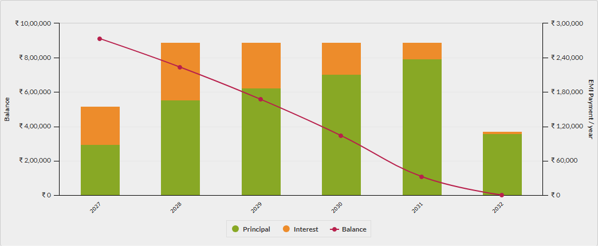
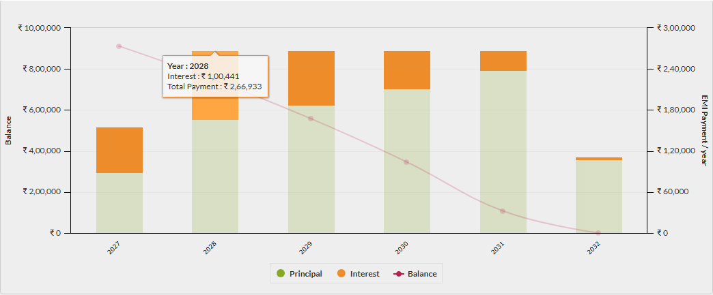
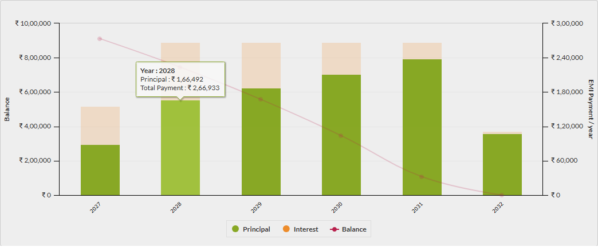
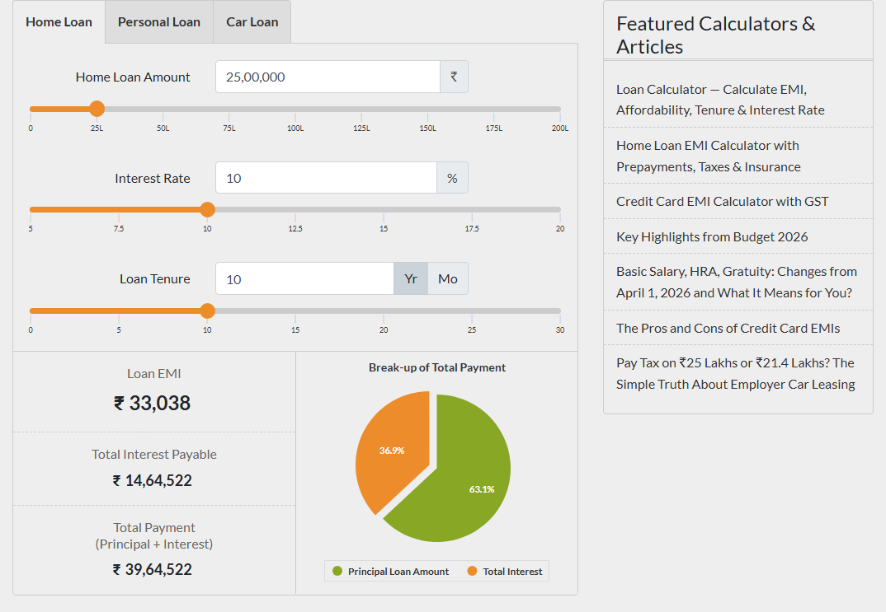
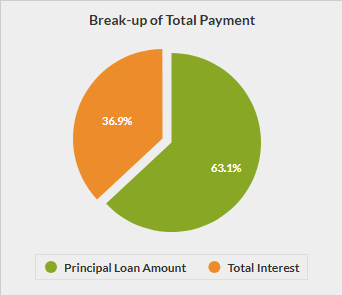
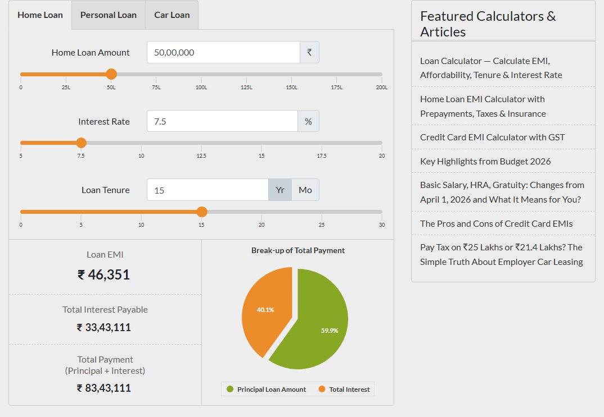
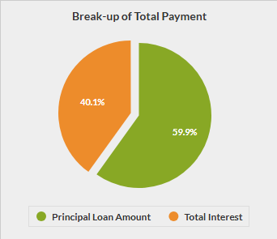
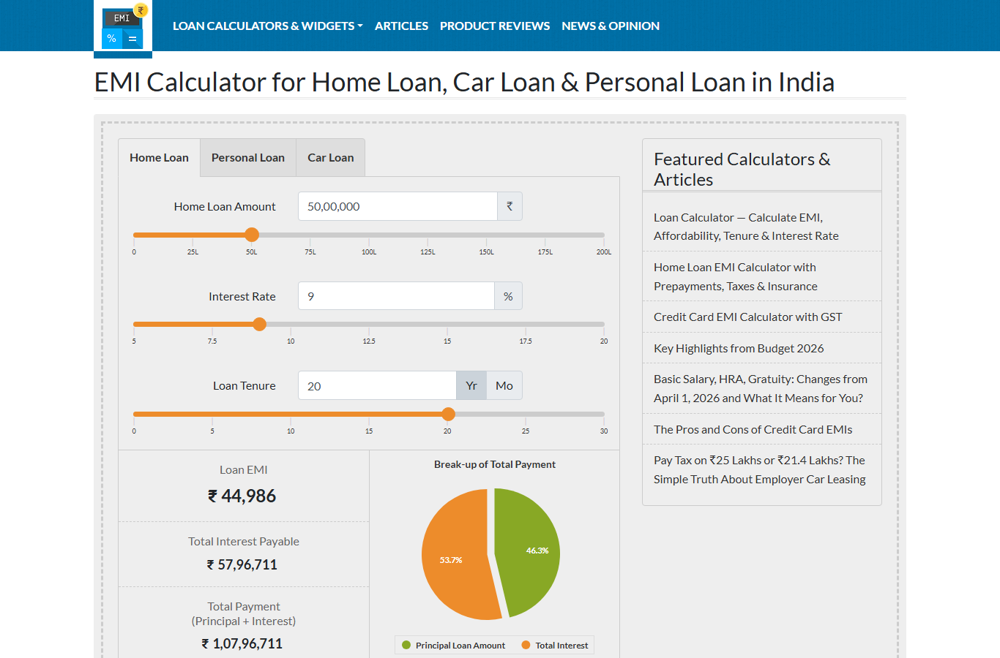
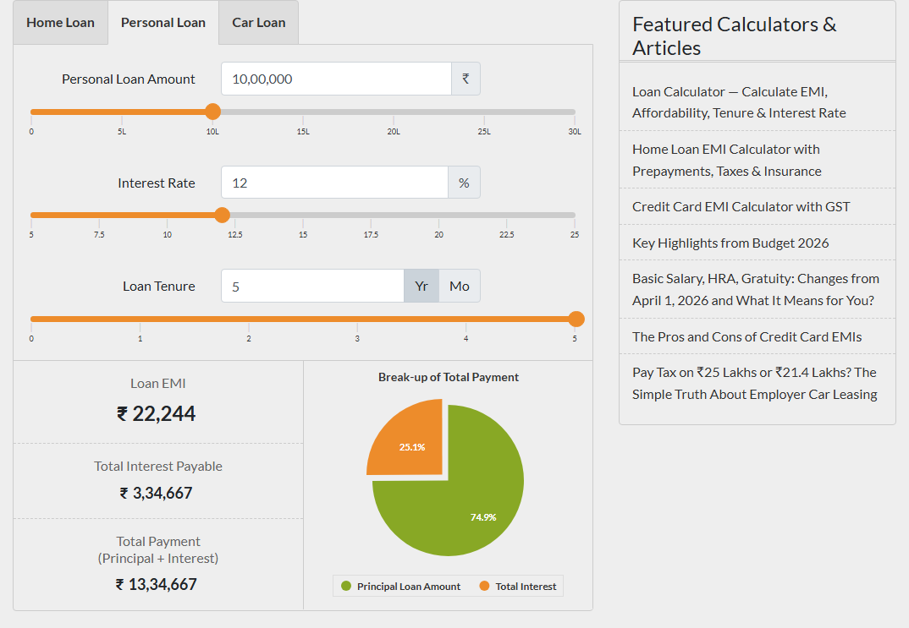

# Test results

Results of the latest local run, written by `npm run report:summary`. Open the HTML reports in a browser for every step, attachment and screenshot.

| Suite | Command | Scenarios | Passed | Failed | Steps | Time | Run at (UTC) | Reports |
| --- | --- | --- | --- | --- | --- | --- | --- | --- |
| B2 API tests | `npm run test:api` | 120 | 120 | 0 | 679 | 1s | 2026-10-27 18:51 | [html](api/cucumber-report.html) [xml](api/junit.xml) [txt](api/console.txt) |
| B3 UI tests (emicalculator.net) | `npm run test:ui` | 3 | 3 | 0 | 22 | 45s | 2026-10-27 18:52 | [html](ui/cucumber-report.html) [xml](ui/junit.xml) [txt](ui/console.txt) |
| B4 SQL tests | `npm run test:sql` | 13 | 13 | 0 | 41 | 16s | 2026-10-27 18:51 | [html](sql/cucumber-report.html) [xml](sql/junit.xml) [txt](sql/console.txt) |
| Self-healing demo, healing off | `npm run test:healing:off` | 2 | 1 | 1 | 9 | 19s | 2026-10-27 18:52 | [html](self-healing/healing-off/cucumber-report.html) [xml](self-healing/healing-off/junit.xml) [txt](self-healing/healing-off/console.txt) |
| Self-healing demo, heuristic healer | `npm run test:healing` | 2 | 2 | 0 | 9 | 19s | 2026-10-27 18:53 | [html](self-healing/healing-on/cucumber-report.html) [xml](self-healing/healing-on/junit.xml) [txt](self-healing/healing-on/console.txt) |
| Self-healing demo, Claude healer | `npm run test:healing:claude` | 2 | 2 | 0 | 9 | 104s | 2026-10-27 18:40 | [html](self-healing/healing-on-claude/cucumber-report.html) [xml](self-healing/healing-on-claude/junit.xml) [txt](self-healing/healing-on-claude/console.txt) |

## Failures

- Self-healing demo, healing off: "Work out a personal loan EMI through four broken locators" failed at "When I open the Personal Loan tab through its brittle locator": locator.click: Timeout 5000ms exceeded.

The healing-off run is meant to fail: it runs the deliberately broken locators as written.

## Screenshots: ui

### 10l personal loan at 12 for 5 years starting june 2027: bar chart

### 10l personal loan at 12 for 5 years starting june 2027: calculated emi

### 10l personal loan at 12 for 5 years starting june 2027: tooltip interest 2028

### 10l personal loan at 12 for 5 years starting june 2027: tooltip principal 2028

### scenario a 25l at 10 for 10 years: calculated emi

### scenario a 25l at 10 for 10 years: pie chart

### scenario b 50l at 7 5 for 15 years: calculated emi

### scenario b 50l at 7 5 for 15 years: pie chart

## Screenshots: self-healing/healing-off

### work out a personal loan emi through four broken locators: failure

## Screenshots: self-healing/healing-on

### work out a personal loan emi through four broken locators: emi read through healed locators

## Screenshots: self-healing/healing-on-claude

### work out a personal loan emi through four broken locators: emi read through healed locators

