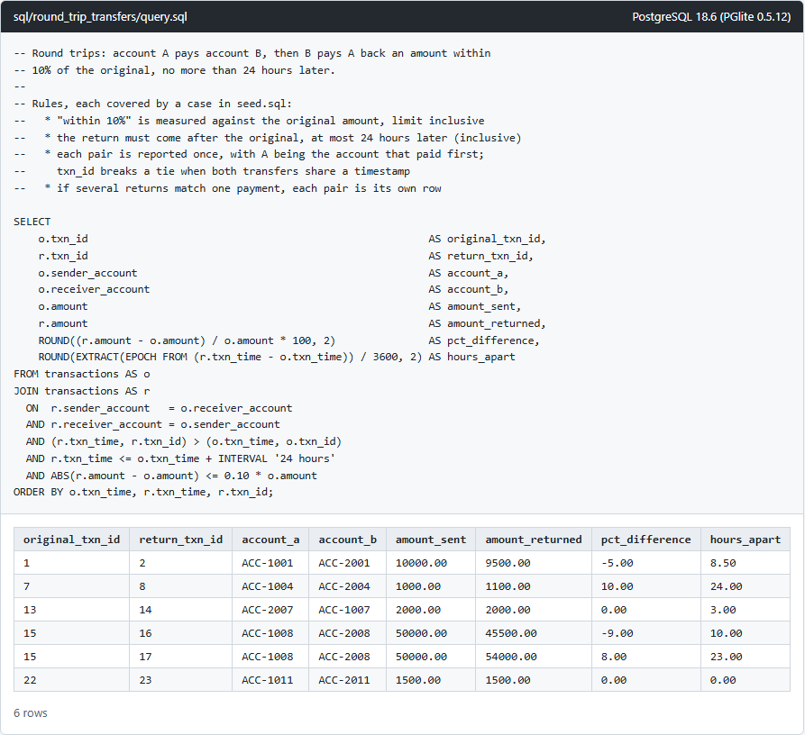
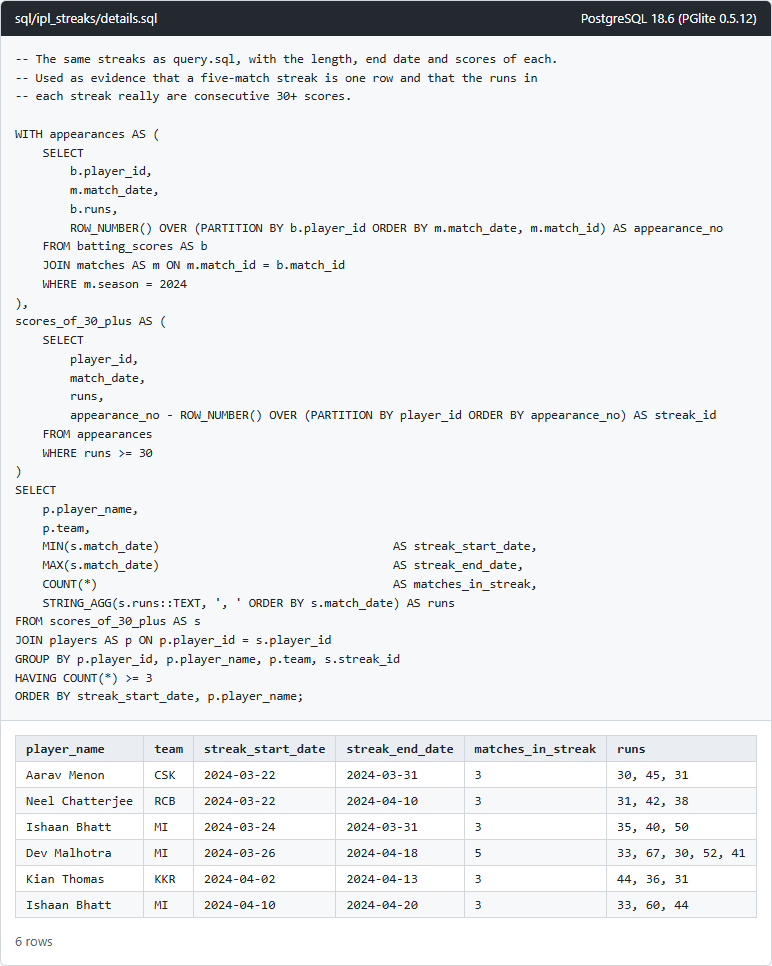

# SQL scenarios (B4)

Each scenario has its own folder with `schema.sql`, `seed.sql` and `query.sql`. The queries are plain PostgreSQL. To try them anywhere, run the three files in order in psql or an online PostgreSQL editor.

The tests run them against [PGlite](https://pglite.dev), which is PostgreSQL 18 compiled to WebAssembly, so `npm run test:sql` needs no database server. `npm run sql:run` runs each query and saves its output to [`results/`](results/) as a psql-style text table and as a screenshot.

## Scenario 1: round-trip transfers

Find cases where account A sends money to account B and B sends a similar amount, within 10%, back to A within 24 hours.

```sql
CREATE TABLE transactions (
    txn_id           INTEGER       PRIMARY KEY,
    sender_account   VARCHAR(20)   NOT NULL,
    receiver_account VARCHAR(20)   NOT NULL,
    amount           NUMERIC(12,2) NOT NULL CHECK (amount > 0),
    txn_time         TIMESTAMP     NOT NULL,
    CHECK (sender_account <> receiver_account)
);
```

[`query.sql`](round_trip_transfers/query.sql) joins the table to itself: the return goes from the original's receiver to its sender, comes later, at most 24 hours later, and differs from the original amount by at most 10%. The rules I chose where the brief leaves room:

- 10% is measured against the original amount, and both limits are inclusive (exactly 10% and exactly 24 hours count).
- Each round trip is reported once, with A as the account that paid first. Comparing `(txn_time, txn_id)` as a pair breaks the tie when both transfers share a timestamp; with `txn_time` alone that pair would be dropped, and with no ordering at all it would appear twice, once per direction.
- If two returns match the same payment, both pairs are reported.
- Amounts are `NUMERIC`, so the 10% boundary is exact. With floating point, 7.70 back for 7.00 fails the check: the difference comes out as 0.7000000000000002 and 10% of 7.00 as 0.7000000000000001.



[`seed.sql`](round_trip_transfers/seed.sql) has one block per case, each commented with whether it should be reported:

| Transfers | Case | Reported |
| --- | --- | --- |
| 1, 2 | 5% less back after 8.5 hours | yes |
| 3, 4 | 12% more back | no |
| 5, 6 | back after 25 hours | no |
| 7, 8 | exactly 10% more, exactly 24 hours later | yes |
| 9, 10 | second payment in the same direction | no |
| 11, 12 | money moves on to a third account | no |
| 13, 14 | the "B" account paid first, so it is A in the result | yes |
| 15, 16, 17 | two returns match one payment | yes, twice |
| 18, 19 | 899.99 back for 1,000: 10.001% less | no |
| 20, 21 | one second past 24 hours | no |
| 22, 23 | same timestamp | yes, once |
| 24, 25 | same accounts as 1 and 2, different amounts weeks later | no |
| 26, 27 | 1,105 back for 1,000: within 10% of 1,105 but not of 1,000 | no |

## Scenario 2: IPL batting streaks

Find players who scored 30 or more runs in at least 3 consecutive matches of the 2024 season, with the date each streak started.

```sql
CREATE TABLE players (player_id INTEGER PRIMARY KEY, player_name VARCHAR(60) NOT NULL, team VARCHAR(10) NOT NULL);
CREATE TABLE matches (match_id INTEGER PRIMARY KEY, season INTEGER NOT NULL, match_date DATE NOT NULL,
                      home_team VARCHAR(10) NOT NULL, away_team VARCHAR(10) NOT NULL);
-- One row per player per match played; runs is NULL for "in the XI, did not bat".
CREATE TABLE batting_scores (match_id INTEGER NOT NULL REFERENCES matches (match_id),
                             player_id INTEGER NOT NULL REFERENCES players (player_id),
                             runs INTEGER CHECK (runs >= 0), PRIMARY KEY (match_id, player_id));
```

"Consecutive" here means consecutive matches the player played, in date order. A match the player was left out of does not break a streak. A match where they were in the XI but did not bat does, because they did not score 30 in it.

[`query.sql`](ipl_streaks/query.sql) uses gaps and islands. `appearance_no` numbers every 2024 match a player played. A second `ROW_NUMBER()` numbers only their 30+ innings. Within an unbroken run both numbers go up by one per match, so their difference stays the same and identifies the run; any match in between without a 30+ score changes it. Grouping by that difference and keeping groups of 3 or more gives one row per streak, however long it is. Comparing each match with the next two using `LAG`/`LEAD` would report a five-match streak three times.


[`details.sql`](ipl_streaks/details.sql) adds the end date, length and scores of each streak:



The names are made up. Each player in [`seed.sql`](ipl_streaks/seed.sql) is one case:

| Player | Case | Reported |
| --- | --- | --- |
| Aarav Menon | exactly 3 in a row (30, 45, 31), so a score of exactly 30 has to count | yes |
| Kabir Sethi | three pairs of 30+ scores, broken by 29 and 7 | no |
| Dev Malhotra | 5 in a row | yes, once |
| Ishaan Bhatt | two separate streaks in the season | yes, twice |
| Neel Chatterjee | left out of one match in the middle; match 108 was replayed later under the same `match_id`, so ordering by `match_id` breaks his streak | yes |
| Vihaan Rao | did not bat in one match in the middle | no |
| Arjun Pillai | 3 in a row at the end of 2023, 2 at the start of 2024 | no |
| Reyansh Dutta | no 30+ scores | no |
| Kian Thomas | 3 in a row across the replayed match | yes |

## How the queries are tested

[`round-trip-transfers.feature`](../tests/features/sql/round-trip-transfers.feature) and [`ipl-streaks.feature`](../tests/features/sql/ipl-streaks.feature) load the schema and seed into a fresh database per scenario and compare the query's output with the expected rows, worked out by hand from the seed data.

Each feature also runs deliberately wrong versions of its query, made by replacing one piece of `query.sql`, and checks that the seed data exposes the mistake:

| Mistake | Effect on the result |
| --- | --- |
| `<` instead of `<=` on the 24-hour window | misses transfers 7 and 8 |
| `<` instead of `<=` on the 10% limit | misses transfers 7 and 8 |
| 10% of the returned amount instead of the original | adds transfers 26 and 27 |
| no ordering between payment and return | adds 2 and 1, the same round trip reversed |
| `r.txn_time > o.txn_time` without the `txn_id` tie-break | misses transfers 22 and 23 |
| ordering matches by `match_id` instead of date | misses Neel Chatterjee |
| no season filter | adds Arjun Pillai, starting 2023-05-14 |
| dropping did-not-bat rows before numbering | adds Vihaan Rao |
| `runs > 30` | misses Aarav Menon |
| `HAVING COUNT(*) > 3` | misses Ishaan Bhatt's first streak |
